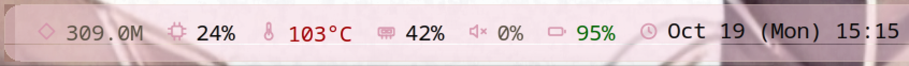

# Chocobar on Linux

A floating translucent bar in the LOWER layer (under normal windows, the same
behaviour as the Windows bar) showing the same chips: pet, the AI token count
the shared scanner produces, the subscription gauge, cpu, ram, cpu temperature,
volume, battery, gpu and clock. It does **not** follow a terminal window around;
it sits where you put it vertically, and with `bar.align: 1` it takes the
**active terminal's width and horizontal position**, so it reads as a strip
along the top of that terminal.



## Build and run

```sh
sudo apt install libx11-dev libxrender-dev libxfixes-dev libcairo2-dev \
                 libdbus-1-dev
bash linux/build.sh                 # -> linux/build/chocobar-linux
./linux/build/chocobar-linux        # reads ~/.wizbar/config.json
./linux/build/chocobar-linux --config /path/to/config.json
```

### Run it supervised (recommended)

The bar is a small X11 client and a compositor restart can take it down. Install
it as a user service and it cannot stay gone:

```sh
cp linux/build/chocobar-linux ~/.local/bin/
cp linux/chocobar.service ~/.config/systemd/user/
systemctl --user daemon-reload
systemctl --user enable --now chocobar.service
```

`Restart=always` with `StartLimitIntervalSec=0` means a kill, a crash, or an
Xwayland hiccup is followed by a restart within ~2 s, and a restart loop is never
given up on. Verified: `kill -9` on the running bar produced a new PID and an
active service 4 s later.

### The gpu chip needs one capability

The gpu chip on Intel hardware reads the i915 PMU's engine-busy counters
(`rcs0-busy` and friends), which the kernel gates behind
`kernel.perf_event_paranoid` (4 on this machine: unprivileged opens are denied).
Rather than weaken that global setting, grant the permission to exactly this
binary with a file capability:

```sh
sudo setcap cap_perfmon+ep ~/.local/bin/chocobar-linux
```

Re-run it after every `cp` install - a fresh copy carries no capabilities. If
the capability is missing the gpu chip stays hidden and the bar logs the exact
command to run (in `~/.wizbar/native.log`). Nothing else in the bar needs any
privilege, and the capability cannot be used to read other processes' memory: it
only allows opening PMU counters. AMD GPUs need none of this - they publish
`gpu_busy_percent` as a plain sysfs file the bar reads unprivileged.

### "As long as the terminal" (`bar.align`)

| `bar.align` | meaning |
|---|---|
| `0` (default) | centre of the screen, content-sized |
| `1` | match the **active terminal's** width and x (the terminal look) |
| `2` | span the whole screen width |

`align: 1` needs a helper, because a Wayland compositor does not let a client
read another window's geometry. Install it once:

```sh
chocobar-linux --install-geometry     # writes a KWin script and loads it
chocobar-linux --remove-geometry      # unload and delete it
```

The helper (`linux/src/geomwatch.js`) is a KWin script that watches the active
window and calls the bar over D-Bus with its `frameGeometry` in logical pixels.
It recognises the terminal classes listed at the top of the script. Switching to
a non-terminal keeps the last terminal's geometry, so alt-tabbing does not move
the bar. A stale report (the script stopped, KWin restarted) is ignored after
30 s and the bar falls back to centring rather than pinning itself to a window
that no longer exists. The bar never becomes narrower than its chips.

Left-click the tokens chip for the dashboard. Right-click opens the menu (the
two dashboards, edit the config, reload, quit). `Esc`/`q` also quits when
the bar has focus. The config is the SAME `~/.wizbar/config.json` the Windows bar
reads, and it hot-reloads on save.

## Measured on this machine (Ubuntu 25.10, KDE Plasma 6.6 on Wayland, 2880x1800)

| what | value |
|---|---|
| memory (RSS) | 50 MB with the subs gauge and libcurl (15 MB was without) |
| CPU, steady state | 0.2% of one core, 1 Hz repaint |
| threads | 2 (main + the subs fetch cycle); one more per extra enabled provider |
| binary | 808 KB, no runtime |
| token scan, cold | ~1.5 s for 2,100 session records, then incremental |
| token scan, warm | a few ms (per-file byte cursors) |
| subs fetch | 147-184 ms per cycle for one provider (api.z.ai), every 2 min |

For comparison the Windows bar quotes ~30 MB and under 1% of total CPU.

## What is shared, what is not

The port is not a rewrite. `linux/build.sh` assembles the same core translation
unit the Windows and macOS builds do - `chocobar.c`, `p_utils.c`, `p_svg.c`,
`p_subs.c`, `p_tokens.c`, `p_agg.c` - and links it against `macos/src/adapter.m`,
which is the POSIX implementation of the Win32 file/dir/string/time/thread seam
and contains no Objective-C (the build compiles it as C, with `-x c`, on every
run). The scanner, the config parser, the subscription fetchers and the chip
rotation are therefore literally the same code, and the totals match the Windows
bar's because they are computed by the same function.

Per-OS parts, written fresh for Linux:

| part | Windows | Linux |
|---|---|---|
| metrics | `p_metrics.c` (PDH, Core Audio, HWiNFO) | `linux/src/p_metrics_linux.c` (`/proc`, `/sys`, `pactl`) |
| icons | `p_icons.c` (GDI+) | `linux/src/icons_cairo.c` (cairo) - same geometry from `p_svg.c` |
| window/paint | `p_ui.c` (layered GDI window) | `linux/src/main.c` (managed X11 window + cairo) |
| subscriptions | `p_subs.c` (WinHTTP) | the SAME `p_subs.c`: its HTTP is a libcurl body under `CHOCOBAR_PORTABLE` |

## Why a managed X11 window in the lower layer

The bar is a MANAGED window carrying `_NET_WM_STATE_BELOW`, `_MOTIF_WM_HINTS`
(no decorations), `InputHint = False` (it can never take the keyboard) and
`USPosition` geometry (KWin honours our exact rectangle instead of placing the
window itself). That combination is the direct equivalent of the Windows bar:
on Windows the bar is pinned in z immediately above the terminal, so raising
another window covers the bar too - it is a lower-layer resident, not an
always-on-top overlay.

It is NOT override-redirect, and that is a measured fact, not a style choice:
KWin composites every override-redirect window in its top layer no matter which
state atoms it carries (probed 2026-10-19 on Plasma 6.6: BELOW, DESKTOP and
DOCK hint combinations all still painted over a raised terminal). The only X11
shape that lands under normal windows is a managed BELOW window. The price of
being managed - decorations, placement, focus - is exactly what those four
properties neutralise.

The bar is not draggable: its position is derived (x and width from the
terminal via `bar.align`, y from `bar.gap`), and a dragged position would break
that contract. Left-click the tokens chip for the dashboard, right-click for
the menu.

On a Wayland session the window is presented through XWayland, which is how most
X11 applications still run on KDE. It is translucent for real: the window is on a
32-bit ARGB visual and its pixels carry an alpha channel, so the compositor
blends it. `_KDE_NET_WM_BLUR_BEHIND_REGION` is set so KWin blurs what is behind
the strip, which is what keeps the text readable over a busy terminal.

The one thing this design cannot do is follow a terminal window: a Wayland
compositor does not let a client position itself relative to another window, and
an X11 client cannot see Wayland-native windows at all. Following was left out on
purpose - see the project README's feasibility notes.

## What each chip reads

| chip | source | note |
|---|---|---|
| cpu | `/proc/stat` delta | same arithmetic as `top` |
| ram | `/proc/meminfo` | used = 100 - MemAvailable/MemTotal |
| temp | hwmon `coretemp`/`k10temp`, then `x86_pkg_temp`, then thermal zones, then `acpitz` | prefers the CPU's own sensor over a lagging ACPI zone |
| volume | `pactl get-sink-volume` | the only source that runs a process; once per second, only while enabled |
| battery | `/sys/class/power_supply/*` | green while charging, red only when low **and** on battery |
| gpu | `amdgpu`'s `gpu_busy_percent`, then the i915 PMU | Intel needs the PMU (see the capability note above); without the capability the chip hides |
| clock | local time, the config's `modules.clock.format` | same `{MMM} {dd} {Wkk} {HH}:{mm}` tokens |
| tokens | the shared JSONL session scan | the chip shows the all-time total; sources may be directories OR single ledger files |
| subs gauge | the shared `p_subs.c` providers | one plan's weekly remaining %, rotating per `subs.rotateSec`; same fetchers as Windows |

### Token sources, including magpie and API-key traffic

`sources[].path` accepts a **directory** (a tree of session `.jsonl` files) or a
**single `.jsonl` file** (a tool that keeps one ledger). A file path was silently
ignored before - the walk only enumerated directories - so a configured ledger
source contributed nothing.

To count magpie's traffic and API-key usage under one name:

```json
"tokens": {
  "enabled": true,
  "labels": { "pi": "pi" },
  "sources": [
    { "app": "pi", "path": "~/.config/magpie/usage.jsonl", "enabled": true,
      "recursive": false, "timestampFormat": "iso",
      "fields": { "input": "in", "output": "out", "cacheRead": "cache_read",
                  "cacheWrite": "cache_write", "timestamp": "t" },
      "providers": ["workbuddy-ai", "workbuddy", "opencode-zen-free", "cline",
                    "qoder", "qoder-cn", "antigravity", "kilo", "zcode"] },
    { "app": "pi", "path": "~/.pi/agent/sessions", "enabled": true,
      "recursive": true, "exclude": ["magpie"] },
    { "app": "pi", "path": "~/.zai/agent/sessions", "enabled": true }
  ]
}
```

The `exclude: ["magpie"]` is what makes the total right, not larger: pi's own
transcripts already record every magpie-routed request, so counting them in both
places would double them. Measured on this machine: magpie's ledger plus pi's
non-magpie routes equalled the bar's total EXACTLY (382,751,319 = 382,751,319).

A sensor that does not exist reads as an em dash, never as a fabricated 0.

### The subscription gauge

The gauge chip fetches through `native/src/p_subs.c` - the SAME provider fetchers
the Windows bar runs (ChatGPT, Z.ai, antigravity, and config-only generic REST
endpoints). The Z.ai provider reads the API key out of the ZCode config the
desktop app already maintains, so no credentials live in this config:

```json
"subs": {
  "enabled": true,
  "intervalMinutes": 2,
  "rotateSec": 60,
  "providers": [
    { "type": "zai", "enabled": true, "label": "zai" }
  ]
}
```

The chip shows the selected plan's WEEKLY remaining percentage and advances to
the next enabled provider every `rotateSec` seconds. `>70%` is green, `>30%`
dim, below that red - the Windows thresholds. `stale` means every provider
failed its last fetch; an em dash means nothing has ever succeeded. The board
(Subscription dashboard in the right-click menu) is Windows/mac only for now -
the menu item says so rather than pretending.

## Tests

`npm test` covers the shared core and the Linux bar's structural invariants (the
ARGB visual, `CWEventMask`, the per-frame clear, the shape region, and that the
icon geometry is shared rather than copied). Each of those guards exists because
its absence produced a bar that looked right and did not work.

The executable token regressions (`scripts/token_regression.py`) are Windows-only;
on Linux the scan is exercised by running the bar against a real store, which is
how the totals quoted above were checked.
